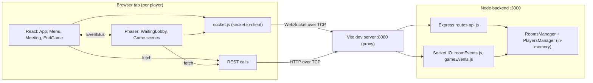
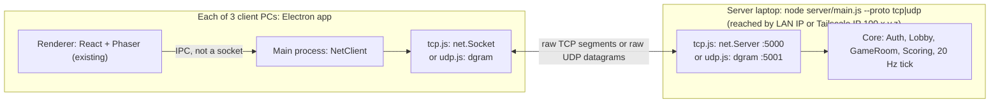
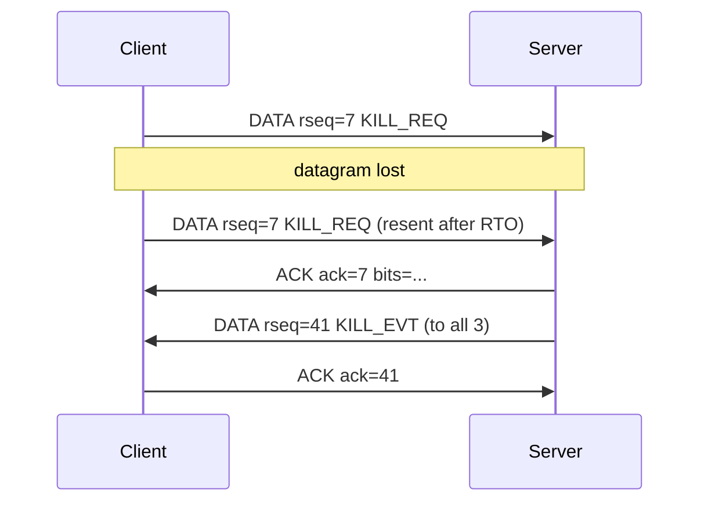

# Among Us Arena — Requirements, Repo Audit & 7-Day Plan

Nov 6, 2026

---

## 1. Summary and the decision that blocks everything

Keep the repo's React + Phaser game, but replace all of its networking. Today it runs only on Socket.IO and HTTP REST (both TCP), and a browser page cannot open a raw TCP or UDP socket, so the UDP-only version cannot exist as a browser web app. The recommended fix is an **Electron desktop client** whose Node side owns a real `net.Socket` (TCP version) or `dgram` socket (UDP version), talking to a transport-agnostic game server. The second gap is gameplay: Among Us has no scores or rankings, and with 3 players one kill ends the round.

> - The repo installs and builds cleanly (Node 22, Vite production build OK). It has 2,974 lines of first-party code.
> - A scripted 3-client test against the real backend reproduced 9 logic and security defects (section 4), including the imposter's identity in the public room list.
> - Missing entirely: UDP, real login, scores and rankings, tasks, body reporting, server-side validation.
> - The cross-network bonus is planned as a required deliverable: **all 4 laptops join one Tailscale overlay network (ZeroTier as backup), the game server runs on the 4th laptop, and the three clients connect from three different networks** (section 7).
> - Limitation: the master prompt file stops at line 145 (start of section 4.3), so any instructions after that were not received.

| Client option | TCP version | UDP version | Verdict |
|---|---|---|---|
| Browser + Socket.IO (current repo) | WebSocket over TCP | Impossible | Rejected |
| Browser + WebRTC DataChannel | n/a | SCTP over DTLS over UDP; needs a TCP signalling server, so not UDP-only | Rejected |
| Browser + WebTransport | n/a | QUIC: its own reliability and TLS; Node server support is experimental | Rejected |
| **Electron desktop client** | `net.Socket` in the main process | `dgram.Socket` in the main process | **Recommended:** same React + Phaser renderer, only raw TCP or UDP leaves the PC |
| Fallback: local Node agent + browser on localhost | Same Node code | Same Node code | Use if Electron cannot be installed; the loopback hop never leaves the PC, but must be explained to the jury |

The renderer talks to the Node side through Electron IPC (not a network socket), so a Wireshark capture on any client shows only TCP segments in one version and only UDP datagrams in the other. That capture is the strongest single proof for the jury. In the cross-network setup, capture on the **Tailscale interface** to see the game packets themselves; the physical interface shows only the encrypted WireGuard tunnel (section 7).

---

## 2. Requirements traceability matrix

Every requirement below comes from `Multiplayer_Game_Arena_Project_2.pdf`; nothing was invented.

**Type:** E = explicit in the brief, B = bonus (treated as mandatory by the team), R = recommended engineering, D = competitive differentiator.

**Owners:** A network core, B server game logic, C client integration, D gameplay/UI, DevOps and presentation (assign names in the first meeting).

| ID | Requirement | Type | Proposed implementation | Owner | Validation |
|---|---|---|---|---|---|
| R1 | Competitive game, not purely cooperative | E | Imposter vs crew per round + individual points and a 3-round match ranking, so every player competes with every other | B, D | Demo shows a ranked leaderboard with 3 different scores |
| R2 | Client-server, 1 server + 3 clients | E | One authoritative Node server; 3 Electron clients | A, C | Server log lists 3 sessions with distinct IPs |
| R3 | Live demo on 4 separate computers | E | Server laptop + 3 client laptops on the team's own router or hotspot (LAN demo); the same 4 laptops on 4 different networks over Tailscale (bonus demo) | D | Rehearsal on Thu 12 Nov on the 4 real machines |
| R4 | Real network sockets, no in-process or simulated clients | E | `net` (TCP) and `dgram` (UDP) in Node; no Socket.IO, no HTTP | A | Wireshark capture on a client during play (physical interface on LAN, Tailscale interface on WAN) |
| R5 | Two versions, identical rules and features, only transport differs | E | One shared game core + protocol; two transport modules; two launch commands (`server:tcp`, `server:udp`) | A, B | Same test checklist passes on both; code diff shows only transport files differ |
| R6 | UDP version meets everything with no TCP; own reliability and disconnection detection | E | Reliable channel (seq, ack, ack-bitfield, retransmit, dedupe, ordering) + heartbeat timeout; UI loaded from local files, not over HTTP | A | Wireshark filter `tcp` shows 0 game packets in UDP version; pull a client's cable: detected within 5 s |
| R7 | Show understanding of TCP vs UDP and how each behaved | E | Live metrics HUD + controlled packet-loss runs on both versions | A, D | Slide 5 chart from logged CSV data |
| F1 | Player registration and login | E | Username + password, scrypt-hashed in `users.json`; server issues a session token used in every later message | B | Register, quit, log in again; wrong password refused |
| F2 | Lobby and room creation | E | Lobby list pushed by server on every change; create room with a 6-character code | B, C | Room appears on the other 2 clients within 1 s |
| F3 | Join or leave a room | E | Join from list; leave button; server enforces capacity (3), unique colors, no join after start | B, C | Join, leave, rejoin on each client |
| F4 | Game start and end, session status | E | Room state machine LOBBY → PLAYING → MEETING → ROUND_END → MATCH_END; host-only start, 3 players required | B | State shown on every client; illegal transitions rejected |
| F5 | Real-time game actions | E | 20 Hz inputs and snapshots; kill, report, meeting, vote, tasks as validated requests | A, B, C | 3 players move and act at once without desync |
| F6 | Scores, rankings, winner | E | Points per event; round and match leaderboard broadcast | B, D | End screen shows ranking 1-2-3 on all 3 clients |
| F7 | Detect and handle unexpected disconnections without crashing | E | TCP: `close` / `error` + 1 s heartbeat, 5 s timeout; UDP: heartbeat timeout; game rules handle a leaver (imposter leaves = crew win, host migrates) | A, B | Kill a client process and pull a cable, in lobby, in play and in a meeting |
| P1 | Live demo of both versions with a real competitive session | E | Scripted 2 × 6-minute demo (section 9) | All | Two full rehearsals |
| P2 | 5 to 7 slides: socket architecture of each version, metrics comparison, friction points, where each protocol did best, simultaneous players and disconnections | E | 7-slide outline in section 9 | D | Dry run timed |
| P3 | Source code for both versions + run instructions; no report | E | One repo, README with per-version commands, release zip of the Electron client | C, D | A non-team member follows the README on a clean PC |
| B1 | Works across different networks, with real communication and setup explained | B | Tailscale overlay network on all 4 laptops (ZeroTier as backup); server on the 4th laptop; clients on campus Wi-Fi + 2 phone hotspots; both versions; direct (non-relayed) path verified before every run | D, A | Section 7 proof checklist |
| X1 | Server authority (no client can cheat) | R | Server validates every action: role, alive, distance, cooldown, phase | B | Re-run the section 4 attack script: all rejected |
| X2 | Repeatable network impairment | R | clumsy (Windows) or `tc netem` (Linux) on the server machine | A | Same loss % gives similar numbers across 2 runs |
| X3 | Smooth remote movement | R | 100 ms interpolation buffer on snapshots | C | No visible teleporting at 0% loss |
| D1 | Tasks, body report, kill cooldown, 3-round match with rotating imposter | D | Section 6 game rules | D, B | Full match plays to the end |
| D2 | Live network HUD (RTT, jitter, loss, retransmits, bytes/s) | D | Overlay toggled with F3 | A, D | Visible during demo |
| D3 | Reconnect within a 10 s grace period | D | Same token re-binds the session | A, B | Unplug and replug Wi-Fi mid-round |

---

## 3. Repository audit: how it works today

The repo is a Phaser React template with a thin, fully client-trusting Socket.IO relay behind it: the server stores what clients tell it and rebroadcasts it, and it validates almost nothing. Versions match the README: React 19, Phaser 3.90, Vite 6, Tailwind 4, Express 5, Socket.IO 4.8 (plus `phaser3-rex-plugins` for color replacement). The backend has a `tsconfig.json` but is plain JavaScript.



### Socket.IO and REST inventory (every message is JSON over TCP)

| Name | Direction | What it does | Problem |
|---|---|---|---|
| `player:register` | C→S | Create or overwrite player with client-chosen id, name, color | Overwrites any id (spoofing) |
| `player:unregister` | C→S | Delete player | Does not remove from room (TODO in code) |
| `player:disconnect` | C→S | Voluntary leave before closing socket | Duplicates disconnect logic |
| `room:create` | C→S | Create room, auto-join host | Broadcast to all connected sockets |
| `room:join` / `room:leave` | C→S | Join or leave room | No capacity or color check server-side |
| `game:start` | C→S | Start if 2+ players, pick random imposter | Any member can start, not only host |
| `player:move` | C→S | Position every rendered frame | Trusted blindly; echoed back to sender |
| `player:kill` | C→S | Mark victim dead, check win | No role, range or cooldown check |
| `meeting:start` / `meeting:end` / `meeting:vote` | C→S | Meeting control | Anyone can start or end; votes keyed by client-sent id |
| `room:send:message`, `player:animation`, `log` | C→S | Chat, animation relay, remote log | No client uses chat or animation |
| `player:registered`, `room:joined`, `room:join:error` | S→C | Acks | `room:joined` contains the imposter field |
| `room:created`, `room:deleted` | S→all | Lobby list updates | No update when player count changes |
| `player:joined`, `player:left`, `player:moved`, `player:killed` | S→room | Game updates | Kill payload carries killer's color |
| `game:started`, `game:ended`, `game:notif` | S→room | Session status | `game:ended` can fire several times |
| `meeting:started`, `meeting:voted`, `meeting:ended` | S→room | Meeting updates | Votes shown non-anonymously |
| `GET /rooms`, `/rooms/:id`, `/player/room/:id` | HTTP | Room and player state | Full room object incl. imposter |
| `GET /isImposter?roomId&playerId` | HTTP | Role lookup | Anyone can ask about anyone |

### Player lifecycle today

1. Page load: App connects the socket and shows a permanent "server might be slow" toast (left over from free hosting).
2. Menu: player types a name, picks a color; the client generates a 16-character id in `sessionStorage` and sends `player:register`. There is no password and no server-issued identity.
3. Lobby list: `GET /rooms` once, then `room:created` and `room:deleted` broadcasts. Name and color uniqueness are checked only in the browser.
4. Create (random 6-character code) or join a room; `room:joined` switches React to the waiting page and mounts Phaser.
5. WaitingLobby scene fetches `GET /player/room/:id`, spawns every sprite at (560, 150), and streams `player:move`.
6. Host clicks Start; server picks a random imposter and emits `game:started`; the Lobby scene fetches `/isImposter` and starts the Game scene with a fog-of-war shader.
7. Imposter clicks the kill button near a player; anyone near the table clicks the meeting button; React shows the voting overlay for 60 s or until everyone voted.
8. After each kill, meeting, leave or disconnect the server checks parity (imposters ≥ crew means imposter wins). With 3 players, the first kill ends the game.
9. EndGame shows Victory or Defeat; "Return to Menu" reloads the whole page. The room keeps `started = true` and cannot be replayed.

---

## 4. Verified defects

Nine defects were reproduced by a script that opened 3 real Socket.IO clients against the unmodified backend (rows marked **Test**); the rest come from reading the code (**Code**). The first four make the current game unwinnable fairly, so any jury member who opens DevTools can break the demo.

| # | Defect | Evidence | Severity | Fix |
|---|---|---|---|---|
| 1 | Imposter identity sent to everyone: the room object with its `imposter` field is returned by `GET /rooms`, `/rooms/:id`, `/player/room/:id` and `room:joined` | Test: the public lobby list returned `imposter = carol` | Critical | Send roles privately in `ROUND_START`; sanitize every room payload |
| 2 | Kill not validated: no role, alive, distance or cooldown check | Test: a crewmate's kill was accepted and ended the game with `isImposter: true` | Critical | Server checks role, both alive, distance ≤ 60 px from server positions, 20 s cooldown |
| 3 | Identity spoofing: any socket can re-register any player id | Test: client C renamed player "bob" to "HACKED" | High | Server-issued session token; id never taken from the payload |
| 4 | Client-authoritative movement | Test: position `x = 99999` accepted and stored | High | Server rejects moves faster than max speed and outside map bounds |
| 5 | Votes recorded under `null`: `MeetingTile.jsx` reads `playerId` from `sessionStorage` when the module first loads, before registration on a first visit | Test: two votes collapsed into `{"null":"alice"}`; the meeting can never end early | High | Voter identity from the session on the server; probably the README's "voting bugs" |
| 6 | Any client can force-end a meeting or start unlimited meetings, dead players included | Test: a non-host's `meeting:end` closed the meeting | High | Only server timer or all-voted ends it; 1 emergency meeting per player per round |
| 7 | Same color accepted for all players | Test: 3 players registered as `#c51111` | Low | Server assigns or checks colors per room |
| 8 | Sender receives its own movement echo; movement sent once per rendered frame (60 to 144 messages/s per client, depending on the monitor) | Test + Code (`BaseGameScene.handleMovement`) | Medium | Fixed 20 Hz send rate; server snapshots exclude nothing, client ignores own entry |
| 9 | `room.started` never resets; no rematch; "Return to Menu" reloads the page | Test: `started = true` after game end | Medium | Room state machine with ROUND_END and MATCH_END |
| 10 | Dead body drawn in the killer's color (`imposter.js` puts `scene.playerObj.color` in the kill payload) | Code | High (gameplay) | Use the victim's color, set by the server |
| 11 | Meeting timer lives in one shared `RoomsManager.meetings.endTimeout`, so meetings in two rooms cancel each other; `endTime` says 10 s but the timeout is 60 s | Code | Medium | One timer per room object |
| 12 | Meeting list built from the room snapshot fetched at scene start, so dead and ejected players stay votable; the voted flag is per tile, so one player can vote on several tiles | Code | Medium | Server sends the live alive list; one vote per voter, with Skip |
| 13 | Host migration on the server is never told to clients (`isHost` set once at join), so a room can lose its Start button | Code | Medium | Broadcast `ROOM_STATE` with `hostId` on every change |
| 14 | Phaser never calls a scene's `shutdown()` method (it emits a `shutdown` event), and `Game.js` removes `game:end` while it registered `game:ended`, so socket listeners pile up across scenes | Code | Medium | `this.events.once('shutdown', …)`; one listener registry in the client network layer |
| 15 | Players who register but never join a room are never cleaned up (the socket-to-player map is filled only on join) | Code | Low | Session cleanup on any disconnect |
| 16 | Hardcoded fake room "1" with a phantom host; permanent "server slow" toast; `log.js` pings `gryzor.co` on every `npm run dev` or `build`; `&` in npm scripts behaves differently on Windows; 432 log lines for one short test round; a new WebGL pipeline created for every colored sprite | Test + Code | Low | Delete; use a log level; reuse one pipeline per color |

The test script lives in the working copy as `smoke.mjs`; keep it and re-run it against the new server as a regression test for X1.

---

## 5. Subsystem assessment

Keep everything the player sees and replace everything that crosses the network. The trick that keeps this inside one week: the new client network layer exposes the same `on` / `off` / `emit` API as `socket.io-client`, so most React and Phaser call sites change only their event names.

| Subsystem | Files | Verdict | Reason |
|---|---|---|---|
| Maps, tilemap collisions, sprites, walk and death animations | `game/scenes/*`, `public/assets` | Keep | Works, looks good, nothing network-related |
| Fog-of-war vision shader | `game/utils/vision.js`, `shaders/fragShader.js` | Keep | Strong visual feature for free |
| React screens: Menu, Meeting, EndGame, Toast, RoleIndicator | `pages/`, `components/` | Keep, refactor | Re-point data to the new state; add login, scoreboard, HUD |
| Phaser ↔ React EventBus | `game/EventBus.js` | Keep | Clean boundary |
| Local player movement and input | `BaseGameScene.handleMovement` | Refactor | Send at fixed 20 Hz, not per frame |
| Remote player rendering | `BaseGameScene._onPlayerMoved` | Replace | Snapshot interpolation instead of position teleport |
| Kill and meeting client logic | `game/utils/imposter.js`, `Game.js` | Refactor | Send requests only; react to server events |
| `socket.js` + every REST fetch | `services/`, `utils/urls.js` | Replace | New NetClient over Electron IPC; zero HTTP |
| Express + Socket.IO server | `server.js`, `routes/api.js` | Replace | Two transport servers (`net`, `dgram`) |
| Event handlers | `events/*.js` | Rewrite | Validation, phases, private messages |
| Rooms and players managers | `managers/*.js` | Refactor | Become one authoritative GameRoom class per room, timers inside |
| Win check | `rooms.manager.js` `checkWin` | Keep, extend | Logic is correct for parity; add tasks and 3-player rule |
| Identity | `Menu.jsx` id generator | Replace | Login + server token |
| Tooling | `log.js`, Vite configs, duplicate Tailwind and PostCSS configs | Refactor | Remove telemetry and duplicates; add Electron scripts |

---

## 6. Target architecture

One authoritative game core, one protocol, two interchangeable transports: the TCP and UDP versions differ only in `server/transport/*` and `client/electron/transport/*`, which is exactly what "same game, only the transport protocol changing" asks for. The server always runs on the 4th laptop; on LAN the clients use its local IP, and for the cross-network bonus they use its Tailscale IP (section 7). The code is the same in both cases.



### Repository layout

```
shared/protocol.js           message types, field validation (used by both sides)
server/core/                 Auth.js, Lobby.js, GameRoom.js, Scoring.js
server/transport/tcp.js      net.Server + length-prefix framing + heartbeat
server/transport/udp.js      dgram + sessions + reliable channel + heartbeat
server/main.js               --proto tcp|udp --port
client/electron/main.js      window + chosen transport; preload.js exposes window.net
client/electron/transport/   tcp.js, udp.js (mirror of the server ones)
frontend/                    existing React + Phaser; services/socket.js -> services/net.js
tools/                       smoke.mjs (attack regression), udp-echo.mjs (network check)
```

### Transport contract

Both servers implement this contract. The TCP version ignores `reliable`: everything on a TCP stream is reliable and ordered, which is the point of the comparison.

```js
// server/transport/<tcp|udp>.js
start(port)
send(sessionId, msg, { reliable })
broadcast(sessionIds, msg, { reliable })
on('connect', sessionId => {})
on('message', (sessionId, msg) => {})
on('disconnect', (sessionId, reason) => {})   // 'closed' | 'timeout'
stats(sessionId)                              // { rttMs, bytesIn, bytesOut, retransmits, lost }
```

### TCP version

- **Framing:** TCP is a byte stream, so one `data` event can hold half a message or three. Each message = 4-byte big-endian length + UTF-8 JSON; the receiver accumulates a buffer and cuts complete frames.
- `socket.setNoDelay(true)` disables Nagle's algorithm; otherwise small 20 Hz messages wait for ACKs and add up to ~40 ms.
- **Disconnection:** `close` and `error` catch clean exits instantly; an application PING every 1 s with a 5 s timeout catches pulled cables and dead Wi-Fi, because OS TCP keep-alive defaults to 2 hours.
- **Expected behavior under loss:** a lost segment blocks every later snapshot until it is retransmitted (head-of-line blocking), so remote players freeze, then jump.

### UDP version

Every datagram carries a binary header, then a JSON payload, kept under 1,200 bytes to avoid IP fragmentation. This limit also fits inside the Tailscale tunnel, whose MTU is 1,280 bytes (1,200 + 28 bytes of IPv4/UDP header = 1,228).

| Field | Bytes | Purpose |
|---|---|---|
| Magic `AU` + version | 3 | Drop foreign packets |
| Type | 1 | HELLO, DATA, ACK, PING, PONG, BYE |
| Flags | 1 | Reliable bit |
| Session token | 8 | Identifies the player even if the NAT changes their port |
| Reliable sequence | 4 | Order and dedupe reliable messages |
| Ack + ack bitfield | 4+4 | Acknowledges the latest reliable seq and the 32 before it |

- **Reliable channel** (login, room, start, kill, vote, round end): the sender keeps each unacknowledged message and resends it after RTO = max(100 ms, 2 × smoothed RTT); the receiver delivers in order, buffers gaps and acknowledges duplicates again.
- **Unreliable channel** (inputs, snapshots, ping): numbered by tick; anything older than the newest received is dropped, so a lost snapshot is simply replaced 50 ms later.
- **Sessions:** the server learns each client's address from the incoming packet (`rinfo`), never from the payload, and re-binds it when a packet with a valid token arrives from a new address or port (for example a client that reconnects on another network).
- **Disconnection:** no packet for 5 s = timeout; BYE = clean leave. Clients send at least one packet per second (inputs or PING). Over Tailscale the tunnel keeps its own NAT mappings alive, so this 1 s traffic is there for disconnection detection and RTT measurement; it would also keep NAT mappings open in a setup without the VPN.



### Message catalogue (same names in both versions)

| Message | Direction | UDP channel | Replaces |
|---|---|---|---|
| `AUTH_REGISTER`, `AUTH_LOGIN` → `AUTH_OK {token}` / `AUTH_ERR` | C↔S | Reliable | `player:register` |
| `LOBBY_LIST` (pushed on every change) | S→C | Reliable | `GET /rooms`, `room:created`, `room:deleted` |
| `ROOM_CREATE`, `ROOM_JOIN`, `ROOM_LEAVE` → `ROOM_STATE {players, hostId, phase}` | C↔S | Reliable | `room:*`, `GET /rooms/:id` |
| `GAME_START` → `ROUND_START {yourRole}` sent privately to each player | C↔S | Reliable | `game:started`, `GET /isImposter` |
| `INPUT {tick, x, y, dir, moving}` at 20 Hz | C→S | Unreliable | `player:move` |
| `SNAPSHOT {tick, players[]}` at 20 Hz | S→C | Unreliable | `player:moved` |
| `KILL_REQ {targetId}` → `KILL_EVT` | C↔S | Reliable | `player:kill` |
| `REPORT_BODY`, `CALL_MEETING` → `MEETING_START` | C↔S | Reliable | `meeting:start` |
| `VOTE {targetId or skip}` → `VOTE_CAST {count}` → `MEETING_END {ejectedId}` | C↔S | Reliable | `meeting:vote`, `meeting:end` |
| `TASK_DONE {taskId}` → `SCORE_UPDATE` | C↔S | Reliable | (new) |
| `ROUND_END {winner, scores}`, `MATCH_END {ranking}` | S→C | Reliable | `game:ended` |
| `PLAYER_LEFT {playerId, reason}` | S→C | Reliable | `player:left` |
| `PING {t}` / `PONG {t}` every 1 s | C↔S | Unreliable | (new: RTT + keep-alive) |

### Game rules for 3 players (starting values; tune on Mon 9 Nov)

- A match is 3 rounds and the imposter rotates, so each player is imposter exactly once. That makes the ranking fair.
- Crew wins a round by ejecting the imposter or finishing all tasks (3 short location tasks each). The imposter wins by killing both crewmates: the parity rule is switched off for 3 players, otherwise the first kill ends the round.
- Kill cooldown 20 s (first kill after 15 s). Reporting a body or pressing the emergency button (once per player per round) starts a 30 s meeting with a Skip option; a tie ejects nobody.
- Points: imposter round win 3, crew round win 2 for each crewmate (alive or dead), kill 1, vote for the actual imposter 1, task 1. Ties broken by kills, then correct votes.

---

## 7. Cross-network bonus (required by the team)

### Chosen solution: overlay VPN (Tailscale, with ZeroTier as backup)

All 4 laptops install **Tailscale** and join the same private network (a "tailnet"). Each laptop gets a stable virtual IP in the `100.64.0.0/10` range (for example `100.101.102.103`). The game server keeps running on the 4th laptop, bound to `0.0.0.0`, and the 3 clients connect to the **server's Tailscale IP** from 3 different networks (campus Wi-Fi and two phone hotspots on different operators). We do it for both versions, not just the one the brief requires.

Why this option:

- Works for both the TCP and the UDP version.
- No router configuration, no port forwarding, no cloud VM to rent or configure.
- Works through most NATs, including 4G/5G carrier-grade NAT.
- About 30 minutes of setup for the 4 laptops; no change to the game code (the server address is already a launch flag).
- The server stays on one of the 4 demo laptops, exactly as the brief describes the setup.
- Traffic is encrypted end-to-end (WireGuard).
- The server address stays the same whatever network the server laptop is on.

Known concern: some graders may see it as "cheating" because the VPN does the hard NAT work. We answer it by explaining exactly what it does (below) and by showing that the game still uses real TCP and UDP sockets over a real Internet path.

### Why this works, in one paragraph for the slides

Each laptop sits behind NAT (home router, campus network or 4G carrier-grade NAT) with a private address, and a NAT drops unsolicited incoming packets, so a client cannot simply connect to a server on another network. Tailscale solves this in four steps. (1) A **coordination server** (control plane) receives each machine's public key and its candidate addresses, and distributes them to the other machines; no game traffic goes through it. (2) Each pair of machines builds an encrypted **WireGuard tunnel**, which runs over UDP (port `41641` by default). (3) To get through the NATs, both peers send UDP packets to each other's public address at the same time (**UDP hole punching**): each NAT sees outgoing traffic, creates a mapping, and lets the other side's packets in, which gives a **direct peer-to-peer path** in most cases. (4) If hole punching fails (for example strict or symmetric NATs on both sides), traffic goes through Tailscale's **DERP relay servers** over HTTPS. Each laptop then has a virtual network interface (`tailscale0` on Linux, "Tailscale" adapter on Windows) with its `100.x.y.z` address, and our sockets use it like any other network.

### What actually travels on the Internet

```
Our game packet (TCP segment or UDP datagram, to 100.x.y.z:5000 or :5001)
        │
        ▼  encrypted and encapsulated by WireGuard
[ Outer IP (public IPs) | UDP :41641 | WireGuard header | encrypted( inner IP | TCP or UDP | game data ) ]
```

- Our game uses **real sockets** and real TCP or UDP; the VPN only adds an outer layer of 60 bytes (20 IPv4 + 8 UDP + 32 WireGuard).
- In **direct mode**, both versions are carried inside WireGuard **UDP** packets on the Internet. Our TCP version still runs its own TCP end-to-end inside the tunnel (handshake, retransmissions, head-of-line blocking), and our UDP version keeps UDP behavior: a lost outer packet is a lost game datagram.
- In **relayed mode (DERP)**, WireGuard packets reach the relay over **HTTPS (TCP)**. For the UDP version this means UDP-inside-TCP: losses on the Internet path are hidden by the relay's TCP connection, and delay spikes (head-of-line blocking) appear instead. This is the risk that made the earlier version of this plan reject the VPN for the UDP version, so we handle it explicitly:
  - Before every WAN run, check that each client reaches the server on a **direct** path (`tailscale ping` shows `via <public IP>:<port>`, not `via DERP(...)`).
  - Record the path type (direct or relayed) with every metrics run.
  - If a client is relayed, move the server laptop to another network (phone hotspot or home Wi-Fi) and test again; if it stays relayed, state it on the comparison slide and explain its effect.
  - Both versions run through the same tunnel, so the TCP vs UDP comparison stays fair.

### Cross-network options

| Option | UDP works | Cost | Verdict |
|---|---|---|---|
| **Tailscale overlay VPN** | Yes, as long as the path is direct (verified before each run); relayed paths carry UDP inside TCP | Free tier is enough for 4 laptops | **Recommended** |
| ZeroTier overlay VPN | Yes (own UDP protocol on port 9993, relays when no direct path) | Free tier is enough for 4 laptops | **Backup:** installed and authorized on all 4 laptops before demo day |
| Azure for Students VM | Yes, open the port in the network security group | $100 credit for 12 months, no credit card, school email | Fallback if the jury rejects the VPN approach; real public server, no tunnel |
| playit.gg tunnel from the server laptop | Yes with the agent program; free-tier UDP availability varies by source, premium is $3/month | Free or $3 | Second fallback |
| Home router port forwarding | Only if the ISP gives a real public IPv4, not CGNAT | Free | Not for demo day: depends on someone's home connection |
| ngrok | No: no UDP tunnel type on any plan | n/a | Rejected |
| DigitalOcean via GitHub Student Pack | n/a | The offer reportedly ended on 31 July 2026 | Do not count on it |

### Setup steps (about 30 minutes, owner D with A)

1. **Create the network.** One team member creates a Tailscale account at <https://tailscale.com> (Google, Microsoft or GitHub login). Simplest for the demo: log all 4 demo laptops into this same account, so they all join the same tailnet. Alternative: invite teammates from the admin console (check the user limits of the free plan).
2. **Install on each of the 4 laptops.**
   - Windows / macOS: installer from <https://tailscale.com/download>, then sign in.
   - Linux: `curl -fsSL https://tailscale.com/install.sh | sh` then `sudo tailscale up`, and open the printed link to sign in.
3. **Name the machines.** In the admin console rename them `server`, `client1`, `client2`, `client3`. Disable key expiry for the 4 demo machines so none of them is logged out before Nov 13.
4. **Get the server's virtual IP.** On the server laptop run `tailscale ip -4` and write the address down (for example `100.101.102.103`). `tailscale status` on any laptop must list all 4 machines.
5. **Run both servers on the server laptop:** `node server/main.js --proto tcp --port 5000` and `node server/main.js --proto udp --port 5001` (two terminals, or pm2). Servers bind `0.0.0.0`, never `127.0.0.1`, otherwise they refuse connections arriving on the Tailscale interface.
6. **Firewall on the server laptop.** In Windows Defender Firewall, allow inbound TCP 5000 and UDP 5001 (or allow Node / the server executable) for both private and public profiles; Windows may classify the Tailscale adapter as a public network. On Linux, open the same ports in `ufw` if it is enabled.
7. **Day-0 network check before any game code exists.** Run the echo tool below on the server laptop, and from each client laptop on each target network confirm UDP round trips to the server's Tailscale IP. Also run `tailscale ping server` (direct or relayed?) and `tailscale netcheck` (UDP allowed? nearest relay?). Do this on campus Wi-Fi on Friday or Saturday, because some campus networks block outbound UDP, which forces Tailscale onto a relay.
8. **If campus Wi-Fi forces a relay**, put the server laptop on a phone hotspot or home Wi-Fi and keep campus Wi-Fi for one client only, then test the direct path again. If a relay cannot be avoided, run the bonus demo with the TCP version (the brief requires only one version) and show the UDP version with the relay clearly stated.
9. **Clients get the server address from a launch flag or the login screen** (`--server 100.101.102.103 --proto udp`), shown in the window title so the jury sees which version and which server is live. The same flag with the LAN IP is used for the LAN demo.
10. **Backup network: ZeroTier.** Create a network at <https://my.zerotier.com>, install ZeroTier on the 4 laptops, run `zerotier-cli join <NETWORK_ID>` (or "Join New Network" from the tray icon on Windows/macOS), tick **Auth** for the 4 members in the web console, and note the server's ZeroTier IP (`zerotier-cli listnetworks`). Test one game session over it.
11. **Full 3-player match over WAN on Wed 11 Nov for both versions;** record the metrics runs (section 9) with the path type of each client, and a backup video.

```js
// tools/udp-echo.mjs — server: node udp-echo.mjs server 5001 | client: node udp-echo.mjs <server Tailscale IP> 5001
import dgram from 'node:dgram';
const [mode, port] = [process.argv[2], Number(process.argv[3])];
const s = dgram.createSocket('udp4');
if (mode === 'server') {
  s.on('message', (m, r) => { console.log('from', r.address, r.port); s.send(m, r.port, r.address); });
  s.bind(port, '0.0.0.0');
} else {
  s.on('message', m => console.log('RTT', Date.now() - Number(m), 'ms'));
  setInterval(() => s.send(String(Date.now()), port, mode), 1000);
}
```

Over Tailscale the server side prints each client's **Tailscale address** (`100.x.y.z`), not its public IP. The public side of the proof comes from `tailscale status` on the server laptop, which lists each peer with the public IP and port it is reached through when the path is direct. A screenshot of the echo log next to `tailscale status` is the best image for the bonus slide: three clients, three different public IPs, one server.

### Proof on demo day

- Each laptop shows its public IP (`curl ifconfig.me`) and network name: four different networks, and at least three different public IPs.
- `tailscale status` on the server laptop lists the 3 clients with their `100.x` addresses and the public endpoints they are reached through.
- `tailscale ping` from each client to the server shows a **direct** path (and its RTT).
- Live server logs on the server laptop show the three client sessions.
- Wireshark on one client, two captures:
  - **Tailscale interface:** our real game traffic, filter `udp.port == 5001` (UDP version) or `tcp.port == 5000` (TCP version).
  - **Physical Wi-Fi / hotspot interface:** only encrypted WireGuard UDP packets (port `41641`) to and from public IPs. This shows the tunnel is what crosses the Internet.
- HUD shows WAN RTT next to the LAN RTT measured earlier; one slide compares LAN vs WAN for both versions, with the path type (direct or relayed) noted.
- Unplug one client's hotspot mid-round: the other two see it leave within 5 s and the game continues.
- One slide explains the setup: NAT problem → coordination server → UDP hole punching → WireGuard tunnel → relay fallback, and what that fallback means for the UDP version.
- Backup video of a full WAN match for each version, in case the venue's network fails.

### Pre-demo checklist for the bonus

- [ ] Tailscale installed and logged in on all 4 demo laptops, key expiry disabled
- [ ] Server's `100.x.y.z` IP written down
- [ ] Both servers bind `0.0.0.0`
- [ ] Firewall rules for TCP 5000 and UDP 5001 on the server laptop
- [ ] Echo test and `tailscale ping` done from each target network, all paths direct
- [ ] Full WAN match done for both versions, metrics recorded with path type
- [ ] ZeroTier installed, joined and authorized on all 4 laptops as backup
- [ ] Phone hotspots charged and with enough data
- [ ] Backup videos recorded
